# Andromon user guide (PC app)

Andromon manages an Android phone from a Windows or macOS computer: messages, contacts, files, photos, apps, the phone's screen and more. This guide shows every page of the app and explains what each option does.

The companion app on the phone has its own guide: [Andromon Companion user guide](https://github.com/Deshan555/Andromon-android/blob/main/docs/USER_GUIDE.md).

The screenshots were taken with an Android 12 emulator and made-up sample data.

## Contents

1. [How the two apps work together](#1-how-the-two-apps-work-together)
2. [Connecting a phone](#2-connecting-a-phone)
3. [The window](#3-the-window)
4. [Overview](#4-overview)
5. [Communication](#5-communication): Messages, Contacts, Call log, Calendar, Notifications
6. [Files & media](#6-files--media): Files, Photos, Music, Backup & restore, Wi‑Fi transfer
7. [Device](#7-device): Apps, Debloat, ReVanced, F-Droid, Controls, Shizuku, Screen mirror, Screenshot
8. [Developer](#8-developer): Test automation, App testing, Developer, Shell
9. [Settings](#9-settings)
10. [If something doesn't work](#10-if-something-doesnt-work)

---

## 1. How the two apps work together

```
 Computer (Andromon)            USB cable or Wi‑Fi             Phone
 ─────────────────────            ─────────────────             ─────
 Files, Apps, Controls,   ──────  adb (Android's own  ───────►  Android itself
 Mirror, Screenshot, Shell        debugging link)

 Messages, Contacts, Calls, ────  the same adb link   ───────►  Andromon Companion
 Calendar, Notifications,                                       (reads what Android only
 Photos, Music                                                  gives to apps on the phone)
```

- Andromon talks to the phone over **adb**, the debugging link built into Android. Nothing has to be installed on the computer besides Andromon.
- Pages that work with Android directly (Files, Apps, Controls, Screen mirror, Screenshot, Shell…) need nothing on the phone.
- Pages marked with **\*** in this guide need the **Andromon Companion**, a small helper app. Andromon offers to install it the first time you open one of these pages; you click **Install companion** once.
- The companion only answers Andromon through the adb link. It can't be reached by other apps or from the network.

## 2. Connecting a phone

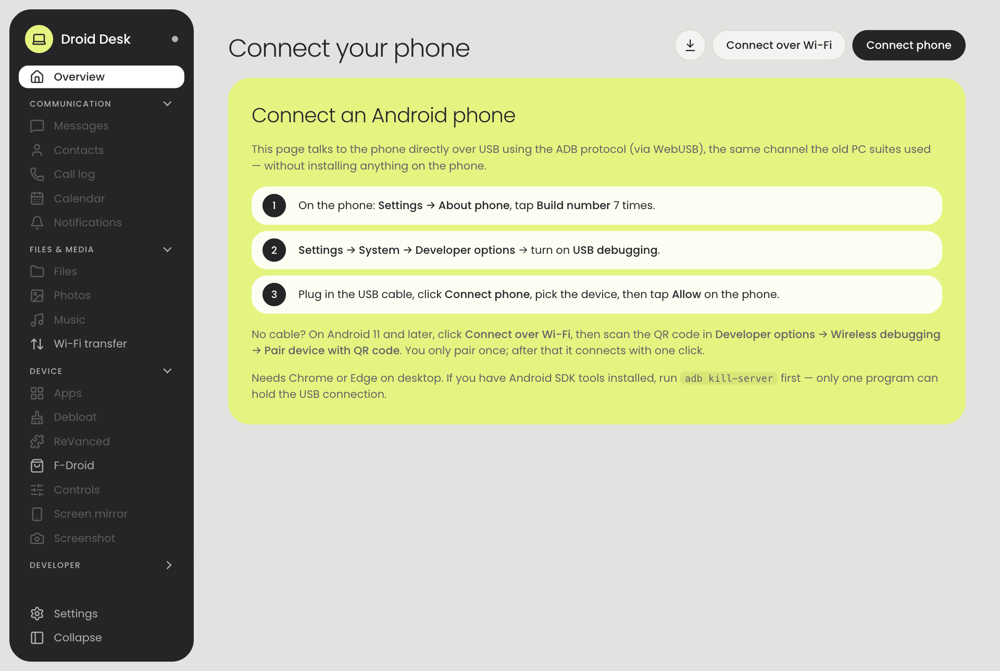

### With a USB cable

1. On the phone: **Settings › About phone**, tap **Build number** 7 times. This switches on Developer options.
2. **Settings › System › Developer options**: turn on **USB debugging**.
3. Plug in the cable, click **Connect phone** (the plug button at the top right), pick the phone, then tap **Allow** on the phone. Tick "Always allow from this computer" to skip this next time.

### Without a cable (Android 11 and newer)

| Way | Steps |
|---|---|
| Easiest | Connect once with the cable and click **Use this phone without the cable** on the Overview. Afterwards, turn on the Wi‑Fi connection in the companion (**PC link › Wi‑Fi**) and the phone appears under **Your phones over Wi‑Fi**. |
| QR code | Click **Connect over Wi‑Fi**. On the phone: **Developer options › Wireless debugging › Pair device with QR code**, and scan the code Andromon shows. |
| 6-digit code | In the same window, choose **Pair with a 6-digit code** and type the address and code from the phone's **Pair device with pairing code** screen. |
| By address | **Connect by address**: type the IP address and port from the Wireless debugging screen. For networks that hide devices from each other. |

You pair only once. The computer and the phone must be on the same Wi‑Fi.

The dot next to "Andromon" in the sidebar is green while a phone is connected. **Disconnect** (top right) ends the session.

## 3. The window

- **Sidebar:** the pages, in four groups. Click a group's heading to fold it; **Developer** starts folded. Pages that need a phone are greyed out until one is connected. **Wi‑Fi transfer**, **F-Droid** and **Settings** work without a phone.
- **Collapse** (bottom of the sidebar, or Ctrl/⌘ + B) shrinks the sidebar to icons.
- **Downloads button** (the arrow at the top right) lists what Andromon is downloading or has downloaded: the ReVanced tools, the F-Droid catalogue and apps, the debloat list.
- A **spinning circle** in the top bar means Andromon is talking to the phone.
- Buttons that delete or change something important ask twice: the first click turns the button into **Confirm?**, the second click does it.

## 4. Overview

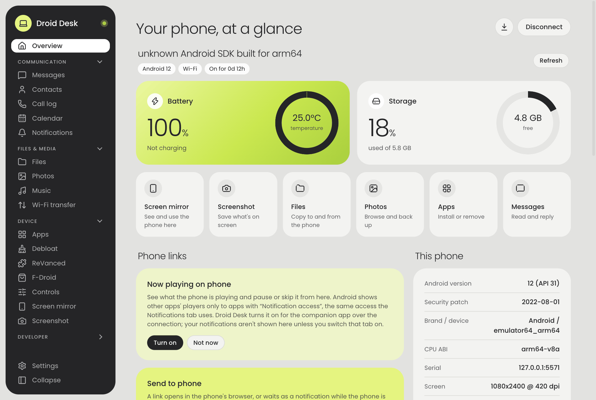

| Part | What it shows or does |
|---|---|
| Name and chips | The phone's model, Android version, how it is connected (USB or Wi‑Fi) and how long it has been on. |
| **Battery** and **Storage** cards | Charge level, temperature and charging state; used and free space. |
| Shortcuts | One click to Screen mirror, Screenshot, Files, Photos, Apps and Messages. |
| **This phone** | Android version, security patch, device, processor type, serial number, screen size. Click a row to copy its value. |
| **Phone links**\* | **Now playing on phone** (cover, play/pause, next/previous, seek), **Send to phone** (a link or text opens on the phone or arrives as a notification), **Shared clipboard** (copy to the phone's clipboard, or fetch the phone's), **Find my phone** (rings at full volume for up to 2 minutes, even on silent). |
| **Use this phone without the cable** | The one-time Wi‑Fi setup described above. |

**Refresh** reads everything again.

## 5. Communication

### Messages\*

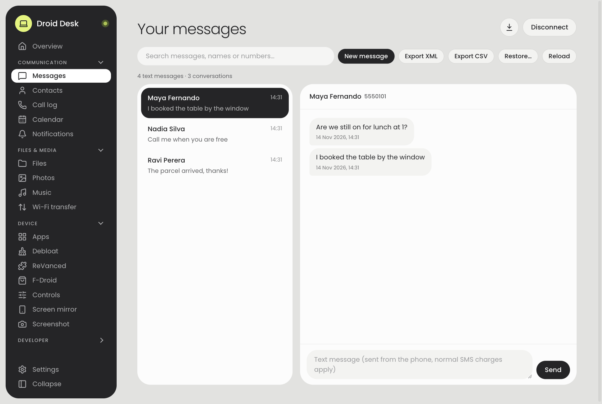

- The left column lists conversations (SMS and MMS together), newest first. Click one to read it; pictures in MMS open or save with a click.
- **Search** looks through texts, names, numbers and attachment names.
- Type at the bottom and click **Send** to reply. The message is sent **by the phone** as a normal SMS, so your usual SMS charges apply. Sending MMS is not supported.
- **New message** starts a conversation with any number.
- **Export XML** saves all messages in the format the "SMS Backup & Restore" app uses; **Export CSV** saves a spreadsheet file.
- **Restore…** reads such an XML file, shows what it holds and adds the text messages that aren't on the phone yet.

### Contacts\*

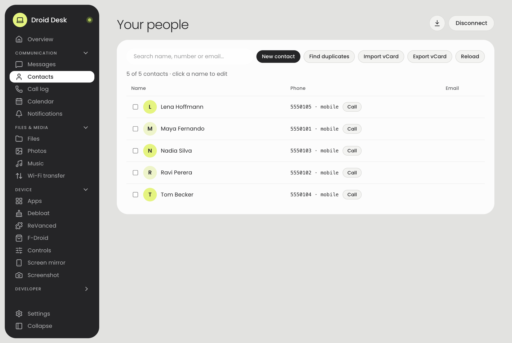

- Click a name to **edit** it: name, numbers, e‑mail addresses, company, birthday, note, favourite, photo.
- **New contact** adds one. Tick contacts to **delete** several at once.
- **Find duplicates** groups contacts that share a phone number, e‑mail address or name. For each group you choose which one to keep; the others' details are merged into it.
- **Import vCard** / **Export vCard** move contacts in and out as `.vcf` files, photos included. Import can skip contacts that already exist.
- **Call** dials the number on the phone (click twice to confirm).

### Call log\*

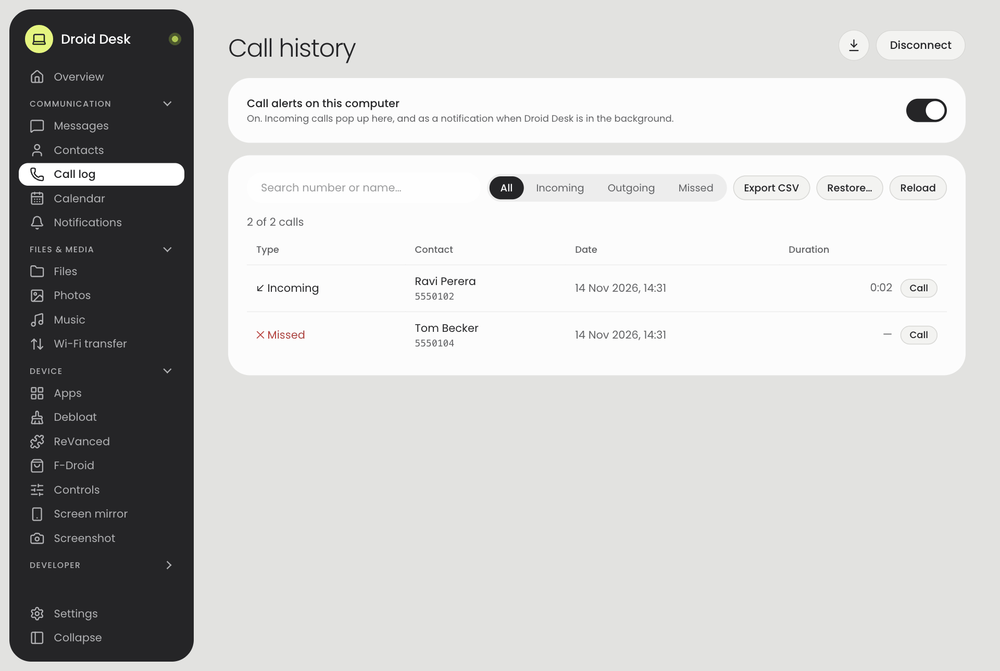

- Filter by **All / Incoming / Outgoing / Missed**, search by number or name.
- **Export CSV** saves the list; **Restore…** adds the calls from such a file that aren't in the log yet.
- **Call alerts on this computer** (the switch at the top): while a phone is connected, incoming calls pop up in Andromon with **Answer**, **Decline** and **Silence**. Answering picks up on the phone; you still talk on the phone. Missed calls stay on screen with **Call back** and **Message**.

### Calendar\*

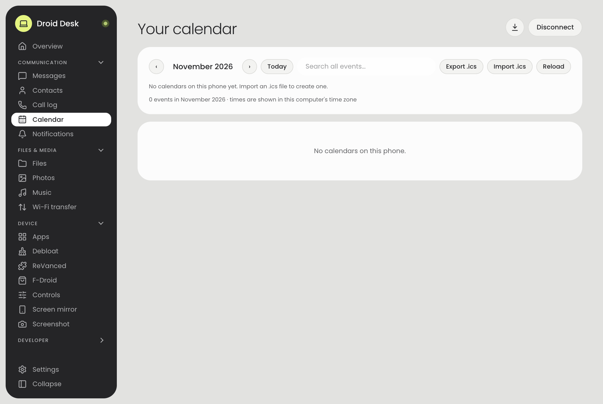

- Shows the phone's calendars one month at a time; the arrows change the month, **Today** jumps back.
- Switch individual calendars on and off, search all events, click an event for its details.
- **Export .ics** saves the calendars that are switched on. **Import .ics** adds events to a calendar you choose, or to a new calendar kept only on the phone.

### Notifications\*

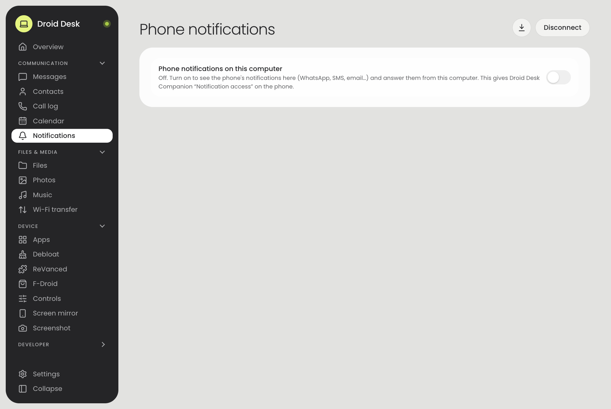

- Off until you turn on **Phone notifications on this computer**. Andromon then gives the companion Android's "Notification access".
- Every notification on the phone (chat apps, SMS, e‑mail…) appears here and as a pop-up.
- **Reply** from the computer where the app supports it, press the notification's own buttons ("Mark as read"…), **dismiss** one or **clear all**.
- Mute pop-ups per app, search, and filter by app.

## 6. Files & media

### Files

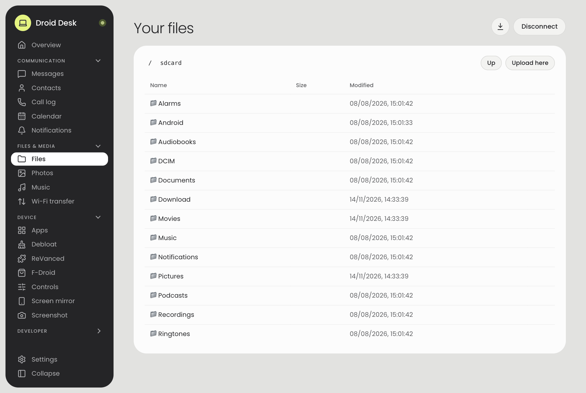

Browse the phone's storage starting at `/sdcard`. Click a folder to open it, **Up** to go back. Files can be downloaded to the computer or deleted, and **Upload here** copies files from the computer into the open folder.

### Photos\*

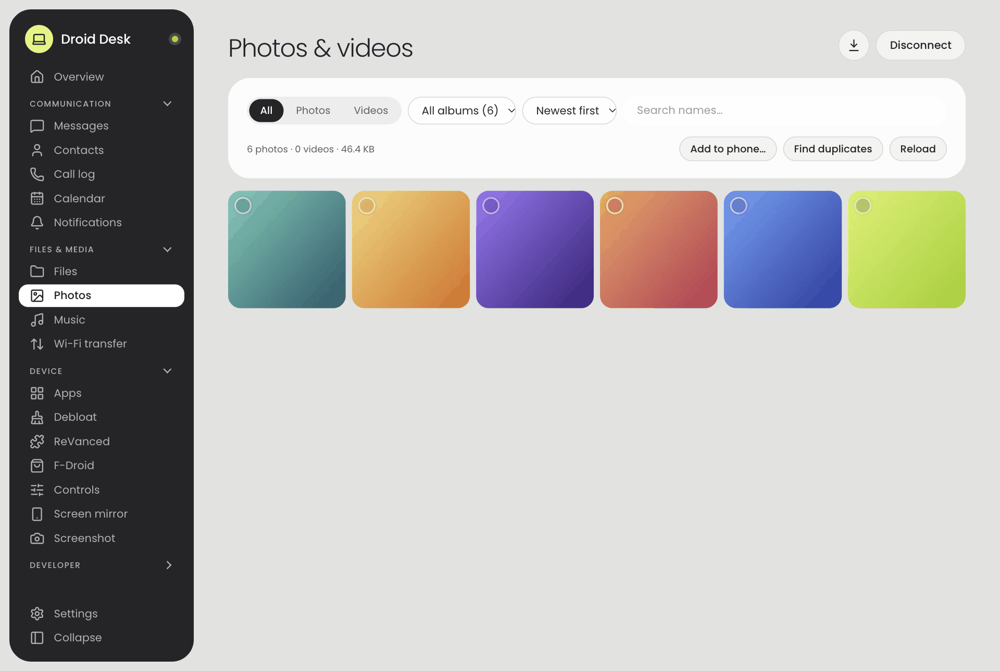

- Filter by **All / Photos / Videos** and by album, sort by date or size, search by name.
- Click a picture to view it full screen (← → keys move on).
- Click the circle on a thumbnail (or Ctrl/⌘-click) to select. Selected items can be **copied to a folder on the computer** or **deleted**.
- **Add to phone…** puts pictures from the computer into the album you are viewing; they show up in the phone's gallery at once.
- **Find duplicates** finds identical files and keeps the oldest copy.

### Music\*

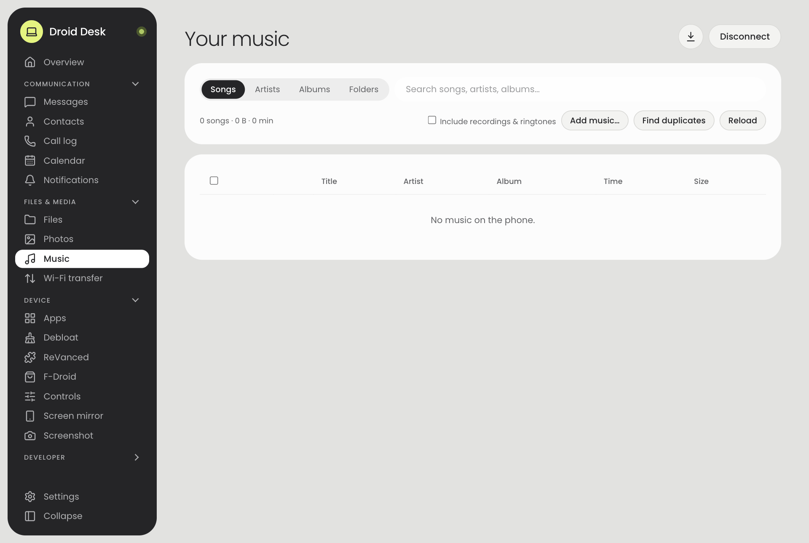

Tabs for **Songs, Artists, Albums** and **Folders**. Click a song to play it on the computer. Select songs to copy them to the computer or delete them. **Add music…** copies songs to the phone. **Include recordings & ringtones** widens the list. **Find duplicates** works as in Photos.

### Backup & restore\*

A page with three cards.

| Card | What it does |
|---|---|
| **Back up this phone** | Tick what to save: contacts, messages, call log, calendar, the list of apps, app installers, photos and videos. **Back up now** writes them into a new dated folder on the computer. Nothing on the phone is changed. |
| **Restore from a backup** | **Restore from a backup…** opens a backup folder, shows what it holds and lets you pick the parts to put back. Only what isn't on the phone yet is added; nothing is deleted or replaced. Apps come back without their data. |
| **Automatic photo copy** | Shows whether new photos are copied to the computer each time the phone connects, and what the last copy did. The switch and its folder are in **Settings › Phone link**. |

### Wi‑Fi transfer

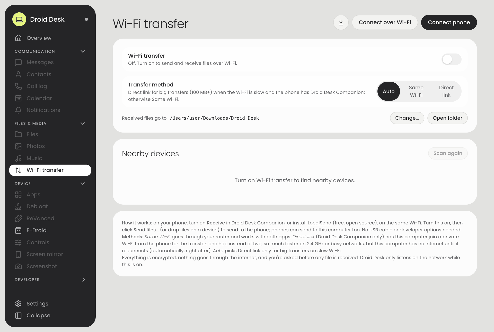

Sends and receives files over the local network, with no cable and no debugging. Works without a connected phone.

| Option | What it does |
|---|---|
| **Wi‑Fi transfer** switch | Makes this computer visible to phones on the same Wi‑Fi. Nothing listens on the network while it is off. |
| **Transfer method** | **Same Wi‑Fi** sends through your router. **Direct link** has the computer join a private Wi‑Fi the phone opens for the transfer (faster for big files; only with the companion). **Auto** picks Direct link for large transfers on slow Wi‑Fi. |
| **Received files go to** | The folder for incoming files; **Change…** picks another, **Open folder** shows it. |
| **Nearby devices** | A radar with this computer in the middle and every phone that is ready to receive around it, next to a list of the same devices with their details. Click a device on the radar (or **Send files…** in the list), or drop files on it. While files move, dots flow between the two and a ring round the device fills up. |

On the phone, open the companion's **Receive** screen and turn receiving on. Every incoming transfer has to be accepted before anything is saved.

## 7. Device

### Apps

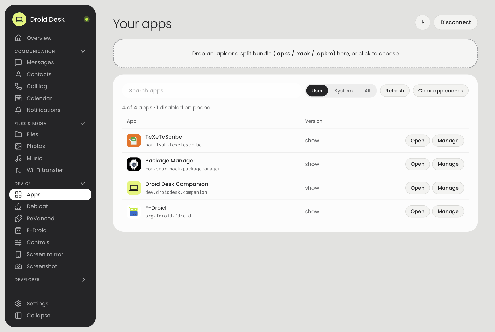

- **User / System / All** chooses which apps are listed; search by name or package.
- **Install:** drop an `.apk`, several split `.apk` files, or an `.apks` / `.xapk` / `.apkm` bundle on the dashed box. A preview shows the app's name, version, required Android version, whether it fits the phone's processor, and its permissions before anything is installed.
- **Open** starts the app on the phone.
- **Manage** opens a panel: version and install dates, **force stop**, **clear data**, **disable / enable**, **export APK**, **uninstall**, and switches for each runtime permission.
- **Clear app caches** frees the caches of all apps at once.

### Debloat

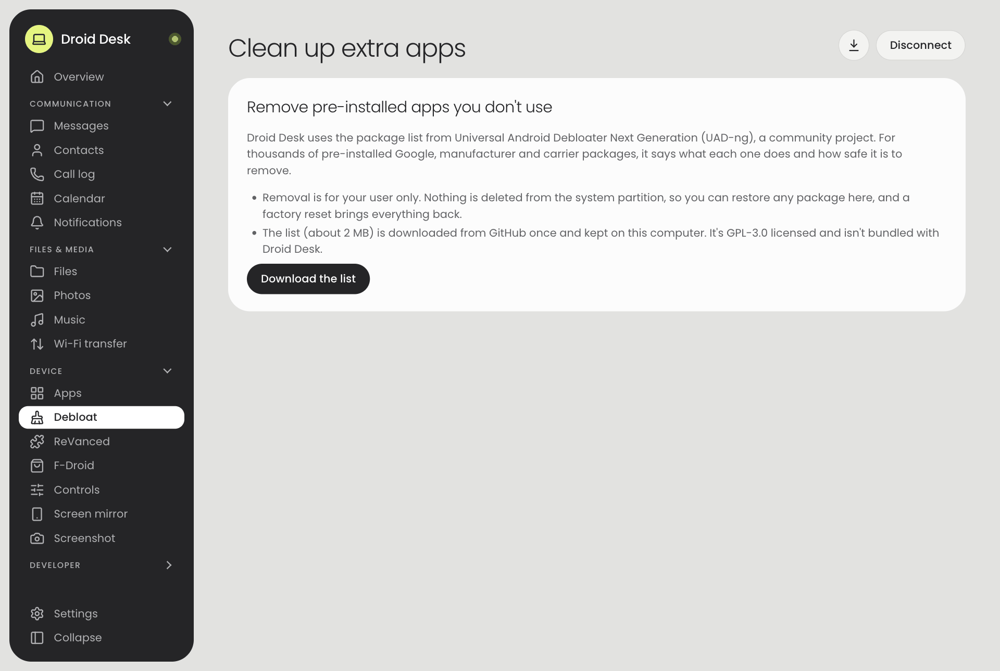

Removes apps that came pre-installed. **Download the list** fetches a community list (Universal Android Debloater Next Generation) that says what each pre-installed package does and how safe it is to remove.

| Option | Meaning |
|---|---|
| **Recommended / Advanced / Expert / Unsafe** | The list's safety rating. Start with Recommended. |
| **Remove** | Uninstalls the package for your user. The files stay on the system partition, so it can be restored. |
| **Disable** | Switches the package off without removing it. |
| **Restore** | Brings back a removed or disabled package. |

A factory reset also brings everything back.

### ReVanced

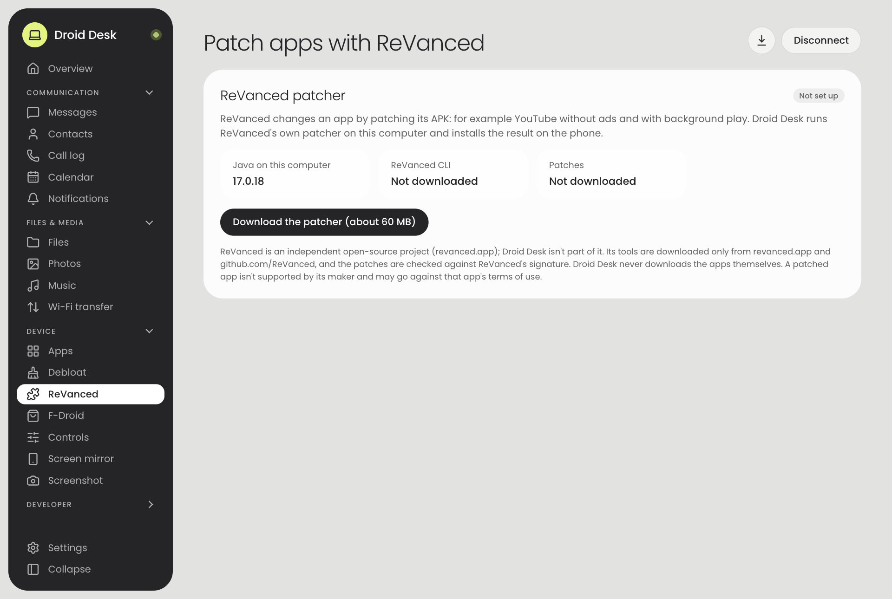

Patches an app with [ReVanced](https://revanced.app) on the computer and installs the result.

1. **Download the patcher** (about 60 MB). Needs **Java 17 or newer** on the computer; the page tells you if it is missing.
2. Choose an app from the phone, or drop an `.apk` file.
3. Tick the patches you want (ReVanced's own choice is pre-ticked) and set their options.
4. **Patch**, then **Install on the phone** or **Save the APK…**.

The page can also install **GmsCore** (needed to sign in with a Google account in patched YouTube) and **ReVanced Manager**. Apps the Play Store installed in several parts can't be taken from the phone: drop a full APK instead. Andromon never downloads the apps themselves.

### F-Droid

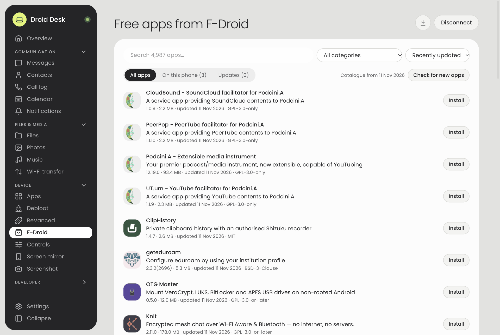

Browse and install free and open-source apps from [F-Droid](https://f-droid.org).

- **Download the catalogue** (about 25 MB) once; **Check for new apps** updates it later.
- **Search**, pick a **category**, sort by **Recently updated / Newest / A to Z**.
- Click an app for its description, version, size, permissions, F-Droid's notes about it (ads, tracking…), every version and its links.
- **Install** downloads the newest stable version that fits the phone and installs it.
- **On this phone** lists the phone's apps that F-Droid has. **Updates** lists those with a newer version; update one at a time or **Update all**.
- Without a phone you can still browse and **Save the APK…** to the computer.

An app installed from the Play Store is often signed with a different key than F-Droid's build. Android then refuses the update and nothing changes; the page says so.

### Controls

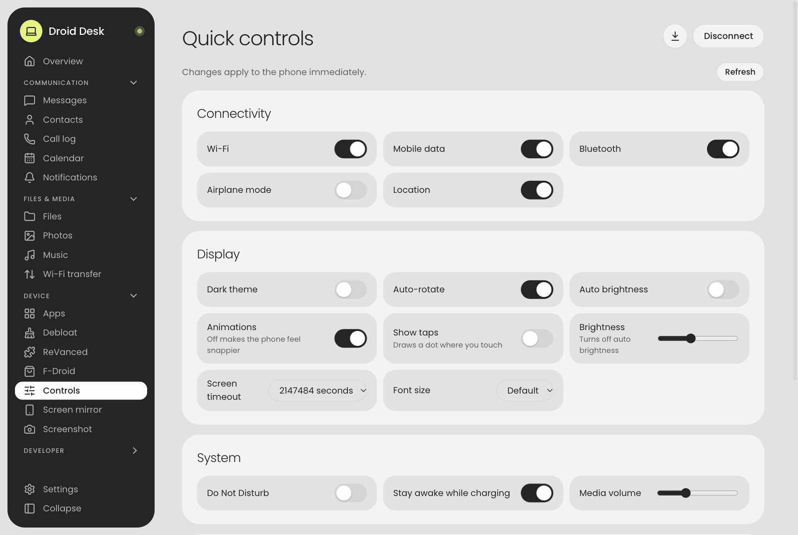

Switches for the phone's own settings. Every change applies to the phone at once.

| Group | Options |
|---|---|
| **Connectivity** | Wi‑Fi, mobile data, Bluetooth, airplane mode, location |
| **Display** | Dark theme, auto-rotate, auto brightness, brightness, animations, show taps, screen timeout, font size, resolution and DPI override (with reset) |
| **System** | Do Not Disturb, stay awake while charging, media volume |
| **Power** | Wake, lock, restart (normal, recovery, bootloader), power off |

### Shizuku

[Shizuku](https://shizuku.rikka.app) is a free app that lends other apps on the phone the rights of adb. The companion uses it so its Freezer, Memory and Battery saver work later without the computer. This page shows whether Shizuku is installed and running.

| Button | What it does |
|---|---|
| **Start Shizuku** | Starts Shizuku over the connection. It keeps running after you unplug, until the phone restarts; on a phone that isn't rooted, start it again after every restart. |
| **Open Shizuku on the phone** | Opens the Shizuku app on the phone's screen. |
| **Get Shizuku** | Shown when the phone doesn't have it: opens Shizuku's download page in your browser. |
| **Check again** | Reads the state again. |

After the first start, give the companion its permission: in the companion, **Settings › Privileged access › Grant permission**.

Below it on the same page is **Phone RAM manager**, Andromon's own helper for phones without Shizuku: it starts a small helper on the phone so the companion's Memory screen can list and stop apps. It lasts until the phone restarts.

### Screen mirror

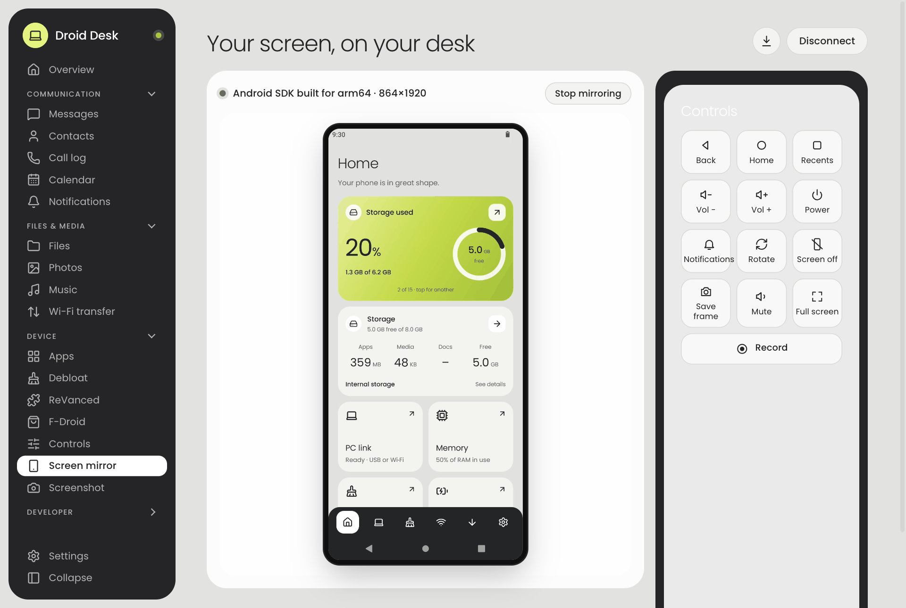

Shows the phone's screen live and lets you use it with the mouse and keyboard.

| Before starting | What it does |
|---|---|
| **Quality** | Fast (720p), Balanced (1080p) or Sharp (full resolution). Lower is smoother on a slow connection. |
| **Show** | The phone's screen, or its back or front camera (Android 12+). |
| **Play the phone's sound here** | Sends the phone's sound to the computer (Android 11+). |
| **Turn the phone's screen off while mirroring** | The phone's own display stays dark while you use it from the computer. |

While mirroring: click = tap, drag = swipe, wheel = scroll, right-click or Esc = Back, and typing goes to the phone. Text copied on either side is shared. The panel on the right has **Back, Home, Recents, Vol −, Vol +, Power, Notifications, Rotate, Screen off, Save frame, Mute, Full screen** and **Record** (saves an MP4 with picture and sound). **Stop mirroring** ends it.

### Screenshot

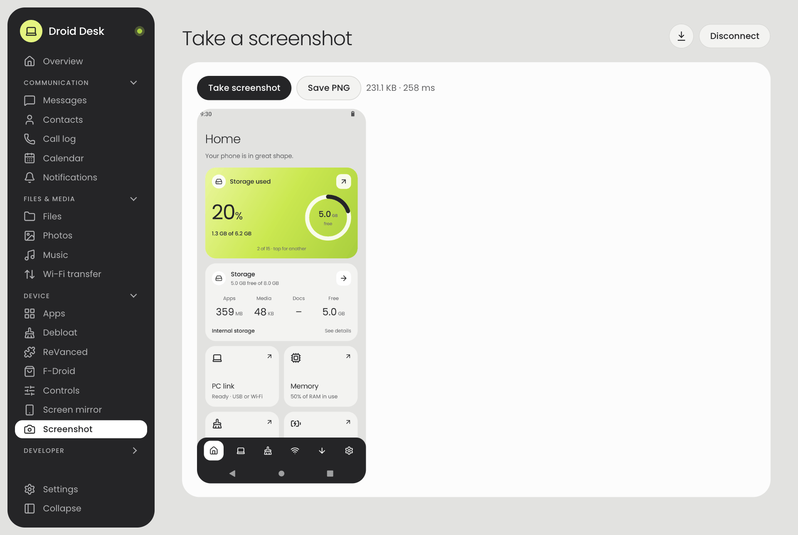

**Take screenshot** captures what is on the phone's screen; **Save PNG** saves it to the computer.

## 8. Developer

These pages are for people who build or test apps.

### Test automation

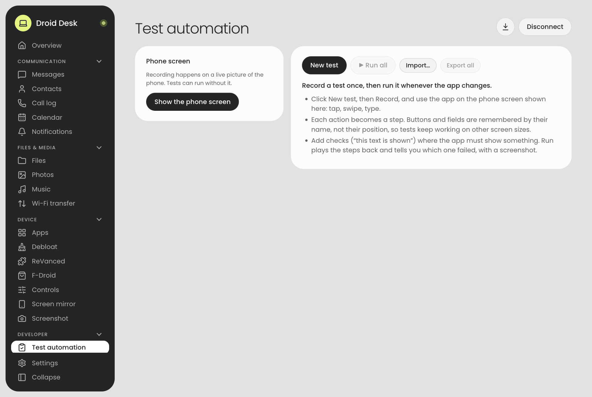

Record a test by using an app on the live phone picture (tap, long-press, swipe, type, Back/Home), then run it again whenever the app changes. Steps remember buttons by their name, not their position. You can add checks ("this text is shown"), waits and screenshots, edit and reorder steps, **Run all**, and export an HTML report or JUnit XML. Tests can be imported and exported as JSON.

### App testing

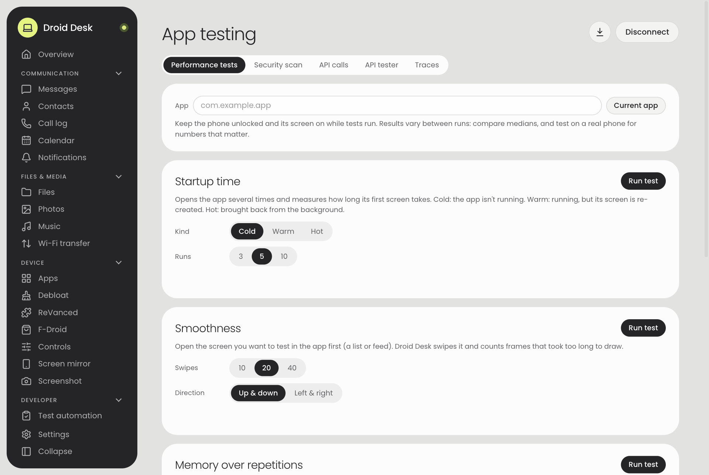

| Tab | What it does |
|---|---|
| **Performance tests** | Measures startup time (cold, warm, hot), scrolling smoothness and memory over repeated use, with limits and history. |
| **Security scan** | Checks an installed app or an APK file for common problems. |
| **API calls** | Shows the HTTP/HTTPS requests the phone makes, through a proxy on the computer. |
| **API tester** | Send requests yourself; keep them in collections with tests. |
| **Traces** | Perfetto traces, method traces and heap dumps. |

### Developer

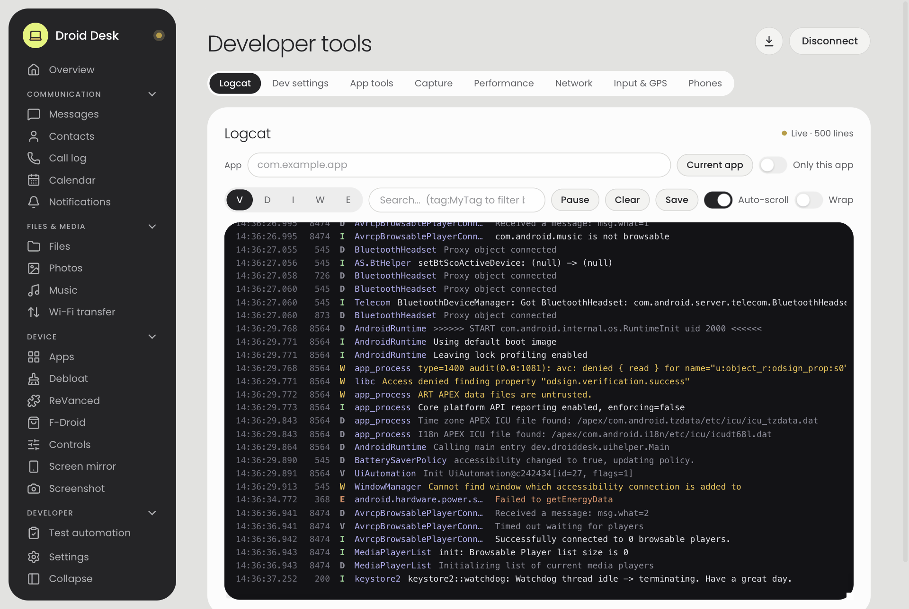

| Tab | What it does |
|---|---|
| **Logcat** | Live log with level filter, search, per-app filter, pause, save and a crash finder. |
| **Dev settings** | Android's developer options as switches. |
| **App tools** | Per app: permissions, save APK, intents and deep links, private storage. |
| **Capture** | Screen recordings and bug reports. |
| **Performance** | Live CPU, memory and frame graphs. |
| **Network** | Port forwarding and a proxy setting. |
| **Input** | Type text on the phone and press its keys. |
| **Fake location** | Pick a place on a map (or search for it) and make the phone report that position; show where the phone is now. The map and search come from OpenStreetMap, so they need internet. |
| **Phones** | Use several phones at once. |

### Shell

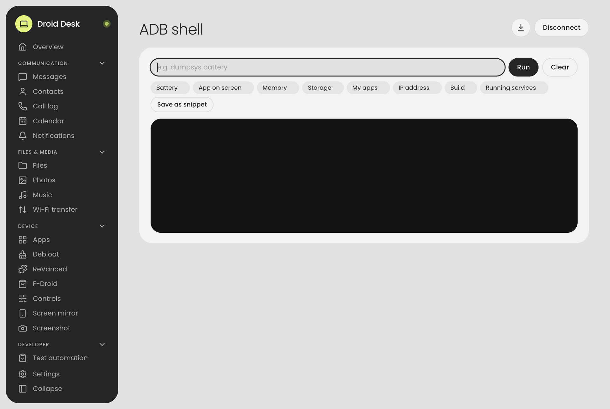

Runs any `adb shell` command and shows its output. The chips under the box are ready-made commands (battery, the app on screen, memory, storage…). **Save as snippet** keeps your own; ↑ and ↓ walk through earlier commands.

## 9. Settings

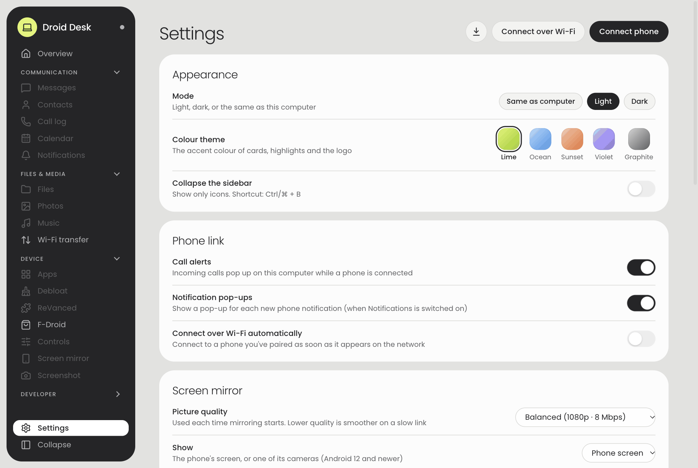

| Section | Option | What it does |
|---|---|---|
| **Appearance** | Mode | Light, dark, or the same as the computer. |
| | Colour theme | Lime, Ocean, Sunset, Violet or Graphite: the colour of highlights, cards and the logo. |
| | Collapse the sidebar | Shows only icons (also Ctrl/⌘ + B). |
| **Phone link** | Call alerts | Incoming calls pop up on the computer. |
| | Notification pop-ups | A pop-up for each new phone notification (when Notifications is on). |
| | Connect over Wi‑Fi automatically | Connects to a paired phone as soon as it appears on the network. |
| **Screen mirror** | Picture quality, Show, sound, screen off, frame rate | The defaults used each time mirroring starts; the same choices as on the mirror page. |
| **Saving files** | Ask where to save each file | On: a save window for every screenshot, recording and export. Off: files go straight into one folder you choose. |
| **Downloads and sources** | ReVanced tools, F-Droid catalogue, debloat list | What has been downloaded, from where and how large; update or remove each. |

Settings are stored on this computer only.

## 10. If something doesn't work

| Problem | Try this |
|---|---|
| **No Android phone found** | Use a cable that carries data (some only charge). Check that USB debugging is on. Close other phone tools (Android Studio, scrcpy, another adb). On Windows, phones with Android 9 or older may need the maker's USB driver. |
| The phone never asks "Allow USB debugging?" | Unplug and plug in again with the phone unlocked. In Developer options, **Revoke USB debugging authorisations**, then reconnect. |
| A page marked \* says the companion is missing or outdated | Click **Install companion** (or **Update**). It takes a few seconds over the cable. |
| The phone isn't listed for Wi‑Fi | Both devices must be on the same Wi‑Fi. Wireless debugging switches itself off when the phone leaves the network or restarts: turn it on again in the companion's **PC link** screen. On guest or office networks use **Connect by address**. |
| An install is refused | Look at the phone: it may be asking to allow the install ("Install via USB", Play Protect). "Signed with a different key" means the app is already there from another source: uninstall it first. |
| Screen mirror has no sound | Sound needs Android 11 or newer. |
